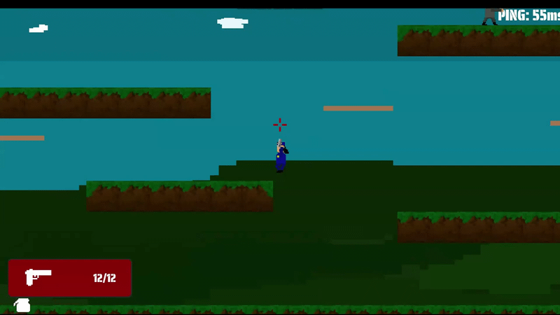
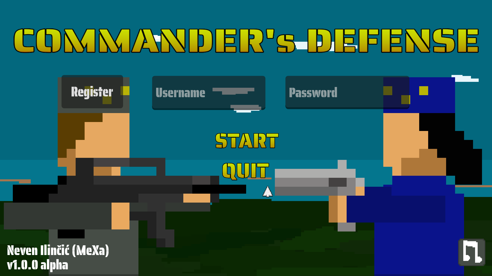
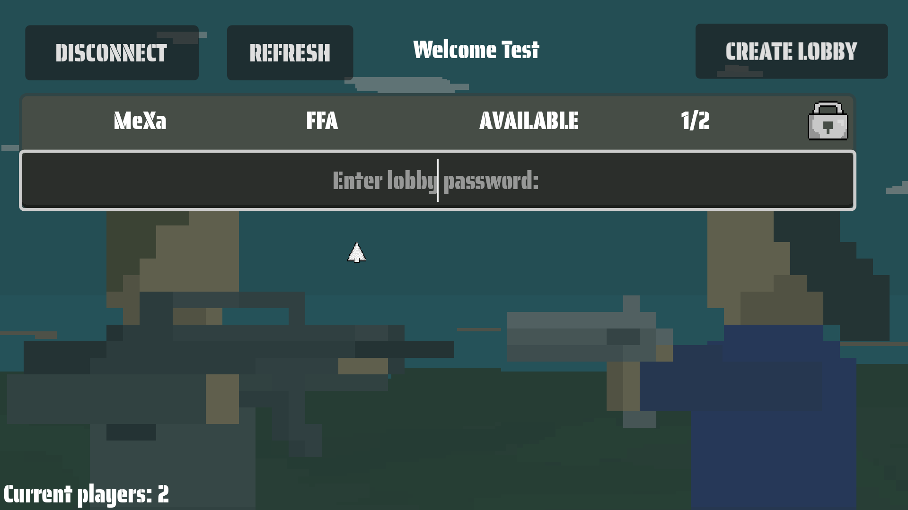
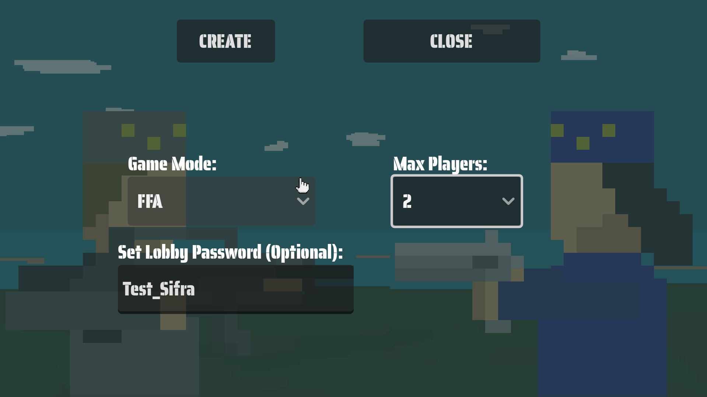
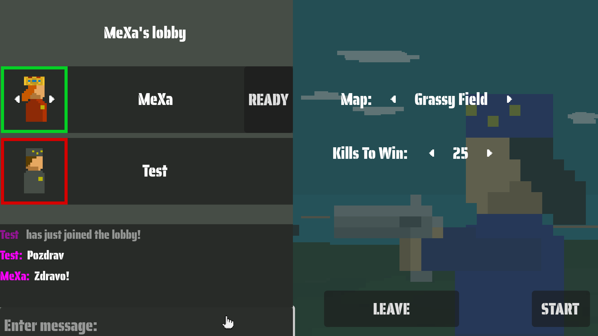
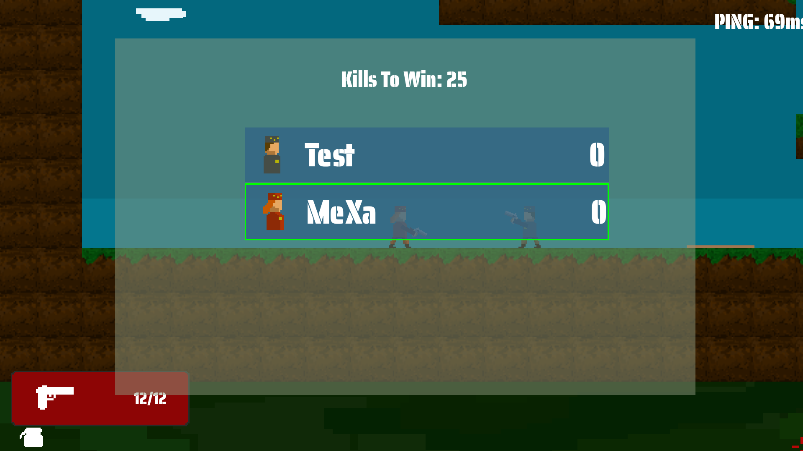
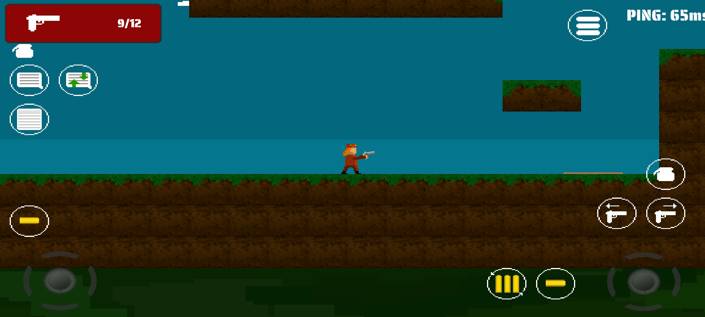

# Commander's Defense

> **2D side-scroll online multiplayer game**

<a href="https://mexa123.itch.io/commanders-defense">
  
  Itch.io game page
</a>
 
<a href="https://youtu.be/wQuEwTjLsg0">
  
  YouTube gameplay preview video
</a>

---

## Gameplay Preview

| Main Menu | Lobbies Menu | Create Lobby Menu |
| :---: | :---: | :---: |
|  |  |  |

| Lobby Menu | Scoreboard | Mobile Version |
| :---: | :---: | :---: |
|  |  |  |

---

## Key game features

- Each player has a gun, a pistol, and one grenade.
- Two game modes:
  - **Tower/Hangar:** Destroy the enemy tower to win the match (2 players).
  - **Free For All (FFA):** Be the first to reach the target number of eliminations to win (2 to 10 players).
- Lobby system (create or join available lobbies).
- In-game chat communication.

---

## Technical focus and architecture

- **Main project focus:** Implementing an online multiplayer game based on a real-time authoritative client-server architecture and compact binary serialization.
- **Architecture:** Implemented a client-server model where **Godot Engine 4.5** serves as the game client (handling rendering, input, and UI) and an authoritative game server written in **Rust** (using **Rapier2D** for deterministic physics simulation). Through this architecture, I implemented and explored key multiplayer networking concepts including **client-side prediction**, **server reconciliation**, and **fixed tick-rate state synchronization**.
- **Hybrid Networking Stack:**
  - **REST API:** Authentication and authorization, along with non-real-time requests (creating, joining, and leaving lobbies, etc.).
  - **WebSockets:** Real-time lobby management (changing player skin, readiness status, game-mode options, map) and in-game text chat.
  - **UDP:** Low-latency real-time gameplay state updates and player input packets.
- **Design Patterns (Client-Side):**
  - **State:** Player movement and behavior are structured through dedicated state classes (`Dead`, `Idle`, `Running`, `Jumping`).
  - **Command:** Client inputs are encapsulated in the `Command` class and sent over to the server.
- **Encountered difficulties:** Although the physics logic is written the same in Godot and Rust, differences in floating-point rounding made it a challenge to achieve the smoothest possible gameplay experience. In order to solve it, two solutions were implementer:  
  - **Severe correction:** If the difference in position exceeds 100 pixels, the player on the client is teleported to the position determined by the authoritative server, and all client inputs that occureed between two server packets are executed.
  - **Slight correction:** If the difference in position is less than 100 pixels, the player on the client is only teleported to the position determined by the authoritative server.
---

## Assets

- **Sprites:** Drawn using [Piskel](https://www.piskelapp.com)
- **Jumping, walking, and button hover sounds:** [BfXr](https://www.bfxr.net)
- **Gunshot and reload sounds:** [Pixabay Sound Effects](https://pixabay.com/sound-effects)
- **Background music:** *Ti se samo usudi* (Instrumental version) — Neven Ilinčić (me), made using [n-Track Studio 10](https://ntrack.com/digital-audio-workstation.php) (Demo version)
